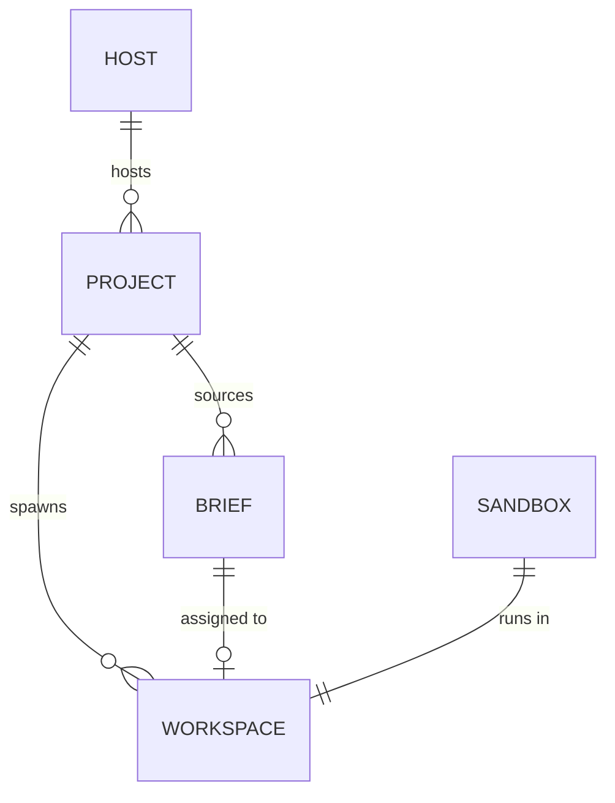

# 👻 Spiritualism

> Get work done with the ghosts in your machine.

> ![NOTE] Do not edit
> This document is historical and not normative — it records what Spiritualism was _conceived_ to be. What the system _is_ lives in `docs/adrs/` and `GLOSSARY.md`; where anything here disagrees with those, they win, and this file is not maintained forward.

This project's goal is to create a user-configurable system in which AI coding agents can perform pre-planned software development tasks in a safe, repeatable way.

Some project tenets:

1. **End-to-end:** Support the user through the entire software development lifecycle, from ticket to pull request.
2. **Deterministic:** Agents can be unpredictable, but we wrap them in deterministic workflows.
3. **Adaptable:** Don't lock users into certain agent harnesses, source code editors, or model providers.
4. **Safety-aware:** Embed mechanisms to prevent agents from doing surprising or harmful things to the host machine.
5. **Terminal-first**: The terminal emulator is the UI surface. Provide a great user experience that supports reach interaction as well as scripting.
6. **Accessible:** Build features that work across a wide spectrum of user ability. a11y isn't an afterthought.

Concepts presented herein are _not set in stone_ and may be incomplete. Readers should question ambiguities, point out inconsistencies, and challenge assumptions in the interest of producing the best plan.

## Glossary

- 👻 **Spiritualism:** The system being described in this document. The name is meant to evoke the idea that coding agents can seem like apparitions operating within your computer.
- 💻️ **Host:** The computer system running Spiritualism.
- 🤖 **Agent:** An AI model running in a software harness that enables it to reason about its environment, use tools, and work iteratively toward a goal.
- 🍱️ **Project:** A directory of source code on the host that Spiritualism has been configured to work on.
- 📝 **Brief:** A description of some desired changes to a project, e.g. a feature, a bug fix, a refactor. Briefs are how users manage work and communicate it to agents.
- 🛠️ **Workspace:** The environment in which a user and agent collaborate on a brief in the context of a project. Projects can have many workspaces. A workspace has only one brief.
- 🔒️ **Sandbox:** An environment for the agent to work in without compromising the host machine, e.g. a microVM, a Docker container.

## Architecture

### Entities

- The host hosts many projects, which are unique per host
- A project sources many briefs, which are unique per project
- A project spawns and manages many workspaces, which are unique per project
- A brief is assigned to at most one workspace
- A workspace runs in a sandbox

### Client-server

Spiritualism implements a **client-server model**. This is intended to facilitate the development of multiple front ends, headless operation, and clear separation of concerns. This will also allow the server and clients to use different tech stacks.

The server program handles core logic, state management, and process handling, while client programs provide a user interface atop the server's public API.

Communication will happen via JSON-RPC 2.0 over a Unix socket. The server maintains PTYs that the client can attach to when direct agent interaction is desired.

Clients will initially consist of a CLI and TUI but could expand to, e.g. a web app, a GUI.

### Sandboxes

Every agent must perform its work within a well-contained sandbox so as not to compromise the integrity of or leak sensitive data from the host environment.

Sandboxing agents is a key safety feature of Spiritualism and is handled by **sandbox providers**, which afford control over filesystem and network access. Sandbox providers implement a common interface for behaviors like:

- Listing sandboxes
- Creating a sandbox
- Stopping a sandbox

The initial sandbox provider will integrate [microsandbox]-backed microVMs. Other backends evaluated include:

- [Gondolin] and [Shuru], which are similar to but less mature than microsandbox
- [Docker containers], which provide a weaker safety guarantee than microVMs
- [Docker sandboxes], which is not open source

### Agents

Agent integration is handled by **agent providers**, which integrate with agent harnesses to implement a common interface for behaviors like:

- Starting an agent
- Stopping an agent
- Getting structured output from an agent

Two harness providers will be available in v1: a built-in provider based on [Pi] and an external provider that integrates with [Claude Code]. Future providers might integrate OpenCode, Codex, etc.

> ![QUESTION]
> Should the built-in agent use the agent provider interface or be considered a special case?

Agents write **artifacts** that persist on the host and are accessible to all agents within a workspace. They maintain a memory file so that future sessions can pick up with a knowledge of the work that has been completed and the decisions that have been made.

### Briefs

Briefs are exposed to Spiritualism via **brief providers**, which implement a common interface for behaviors like:

- Listing/filtering briefs
- Updating a brief
- Generating a workspace name (e.g. based on the brief title)

The initial brief provider will be one that operates on the filesystem, treating Markdown files as briefs. Future providers will connect to third-party project management systems like Shortcut, Linear, or GitHub Issues.

## Configuration

There are two levels of Spiritualism configuration: **global** and **project**. Global configuration lives at `$XDG_CONFIG_HOME/spirit/config.toml` and project configuration in the project root directory at `.spirit/config.toml`.

## Command-line interface

The command-line interface (CLI) is a client of the Spiritualism server. It exposes a single top-level command, `spirit`, and subcommands for working with projects, briefs, agents, workspaces, sandboxes, et al.

## Terminal user interface

The terminal user interface (TUI) is a client of the Spiritualism server. It is launched by calling the `spirit tui` command. The TUI is composed of three main areas:

| Tab        | Purpose                                                   |
| ---------- | --------------------------------------------------------- |
| Dashboard  | Kanban board of briefs by status, detail pane             |
| Briefs     | List/table view with filtering, CRUD                      |
| Workspaces | Workspace list, live JSONL event stream, attach, controls |

[claude code]: https://code.claude.com/docs/
[docker containers]: https://docs.docker.com/engine/
[docker sandboxes]: https://docs.docker.com/ai/sandboxes/
[gondolin]: https://earendil-works.github.io/gondolin/
[microsandbox]: https://docs.microsandbox.dev/
[pi]: https://pi.dev/
[shuru]: https://shuru.run/
